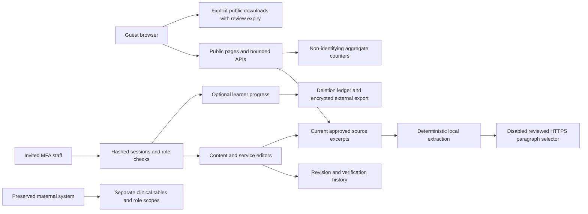

# SafeHer architecture and data boundaries

Identity: existing Organization/User/Session/PasswordReset models; SafeherEnrollment provides hashed expiring invitations and encrypted pending MFA secrets. Current sessions are checked against database status, expiry, revocation version, and production staff MFA.

Content: SafeherContent holds the current lesson; SafeherRevision holds immutable versions, approval decisions, reviewer identifiers, locale, dates, expiry, and the full structured lesson including source URL/name. Source attribution is embedded in each version so later edits cannot rewrite historical source evidence. SafeherTranslation references an exact English source version and has independent version/status/reviewer/expiry. Translation revision history uses `sourceSlug:locale` keys. Public English retrieval excludes drafts, missing/expired reviews, and demo-only material outside demo mode.

Directory: SafeherService holds current contact metadata, explicit expiry, publication state, accessibility confirmation, and partner assignment. SafeherServiceReview records historical snapshots and evidence actions. Region remains a service field; national enquiry scope is explicit and never treated as a physical location in every region. Sources and region labels are preserved in review snapshots rather than separate mutable lookup records. A future geographic localization release can add normalized lookup tables without changing historical evidence.

Metrics: SafeherMetric aggregates day/event/locale with small-cell suppression. Counts are events, not unique users or proven outcomes. SafeherFeedback uses fixed non-identifying categories. AuditEvent records redacted administrative actions; questions and disclosures are not persisted. History contains operator IDs and must remain staff-restricted.

Deletion: SafeherDeletion retains minimal user ID/scope/time for restore reconciliation. Export it encrypted outside the database backup lifecycle. Clinical data is not deleted by learner rights endpoints. Foreign-key cascades remove learner progress/sessions/reset tokens; enrollment records are separately purged by restore tooling.

Network trust: browser Origin validation precedes mutations; streaming readers enforce byte limits. Session/trusted-edge rate keys are hashed. Proxy nonces protect scripts; public HTML is dynamic and no-store. Hosted edge/WAF, private database connections, region approval, separate environment secrets, backups, and monitoring are deployment responsibilities tracked in the launch register.
