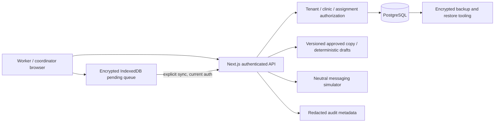

# Architecture

One deployable modular monolith. Server-side scope checks protect each care query and mutation. Clinic coordinators are operationally authorized within their clinic; all detail views are audited. Programme admins and auditors cannot retrieve mother lists, contacts, or care timelines. Aggregate programme and audit views suppress cells under 10.

Database transactions contain mutations and audits. Serializable transactions protect idempotent offline replay and competing changes. Version mismatch, stale consent, revoked assignment, and disabled sessions are rejected. Client mutations do not optimistically commit server state: forms remain editable on failure and errors are announced.

No personalized data is placed in shared HTTP or service-worker caches. No AI provider requests are made. The deterministic assistant accepts only source IDs/locales, retrieves organization-approved sources, stores provenance, and produces unapproved drafts. Local-language templates are not published by this release.

Sessions use 256-bit opaque tokens with a user revocation-version prefix, hashed in full server-side, in HttpOnly SameSite=Strict cookies. Each request verifies the current version. Session issuance checks the version captured at password verification, preventing a racing sign-in from surviving a password reset. Passwords use bcrypt with cost 12. The deployment origin determines secure cookie behavior. Recovery tokens are hashed, single-use, 15-minute, and revoke all sessions after password change. TOTP setup requires password verification, uses atomic state checks, and rejects reused codes. The local mailbox simulator is disabled for hosted production builds.

The PWA has a safe public offline registration shell. Offline reads are intentionally limited to already-loaded in-memory records. AES-GCM encrypts pending payloads with a tab-held session key; encrypted data expires after 24 hours and logout removes it. This does not substitute for managed-device controls.
